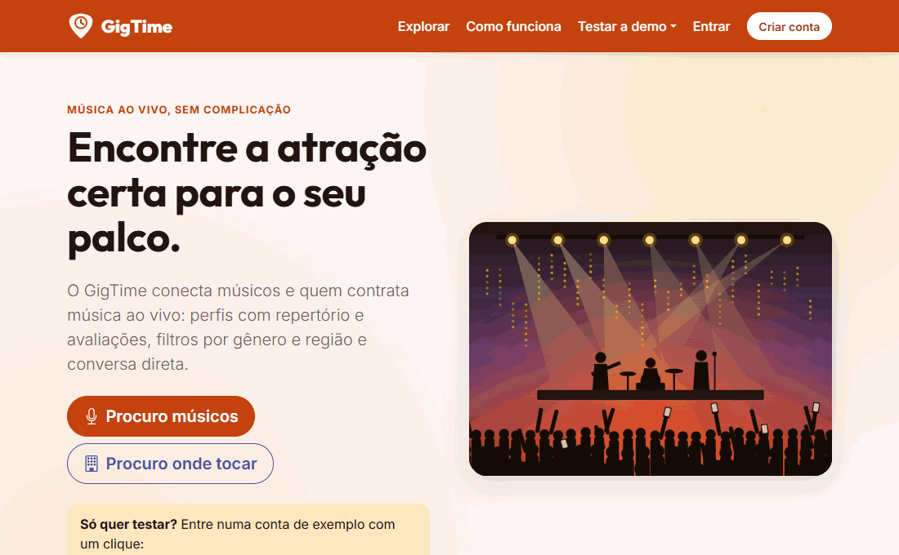
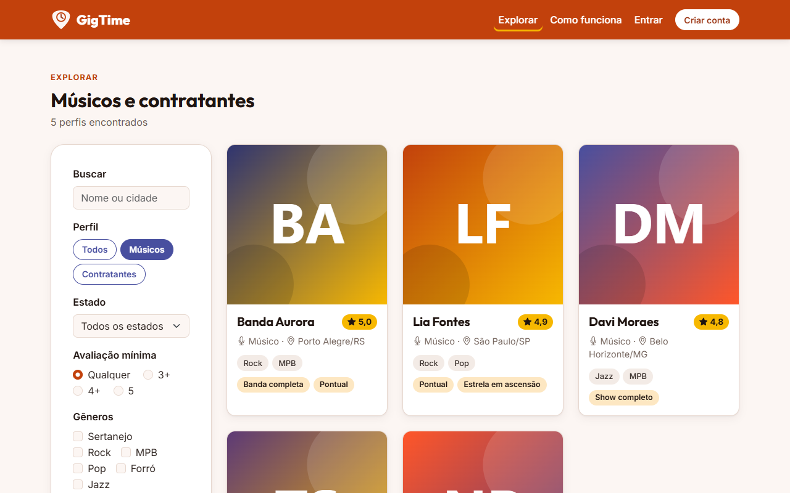
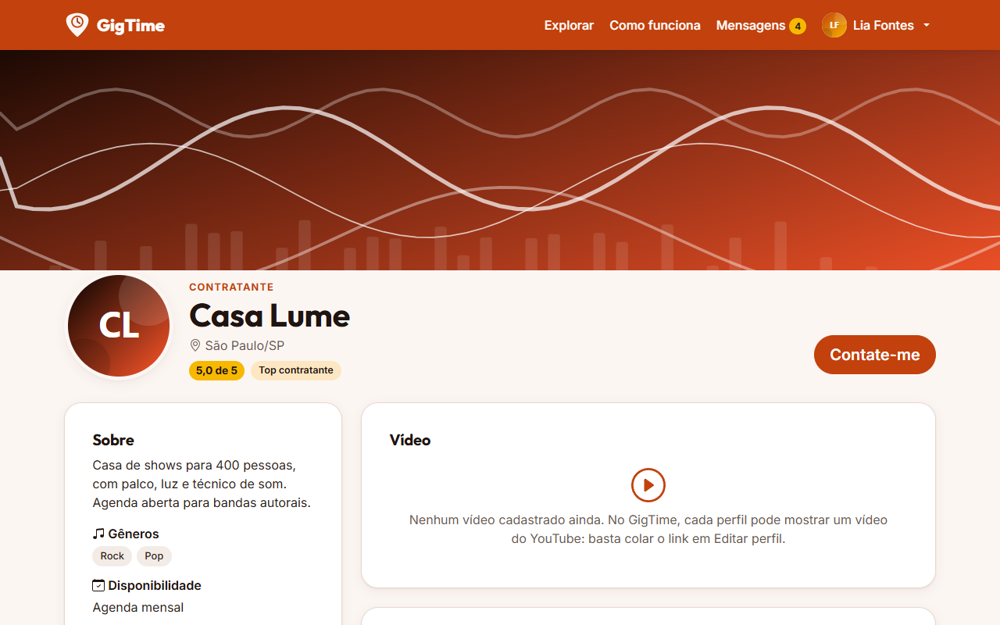
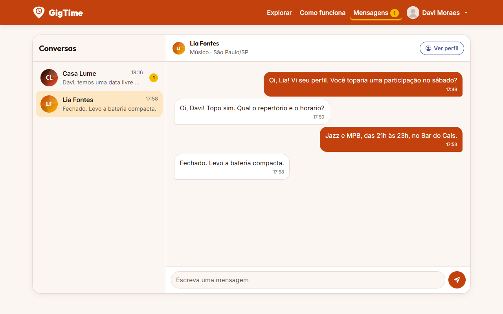
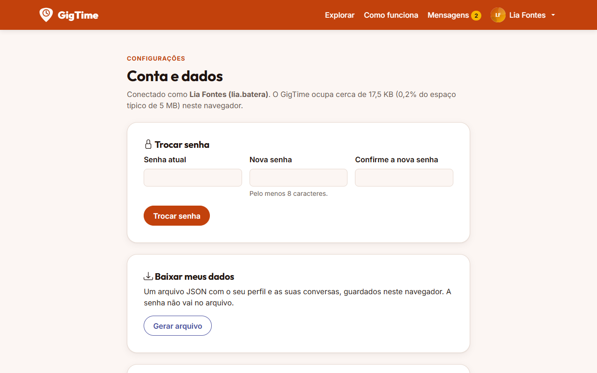
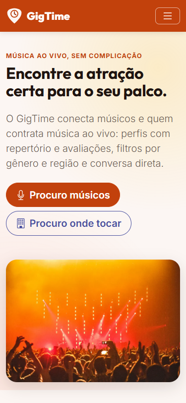
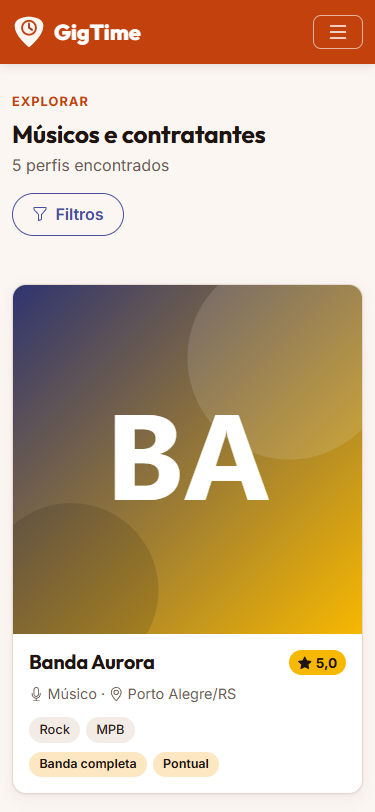
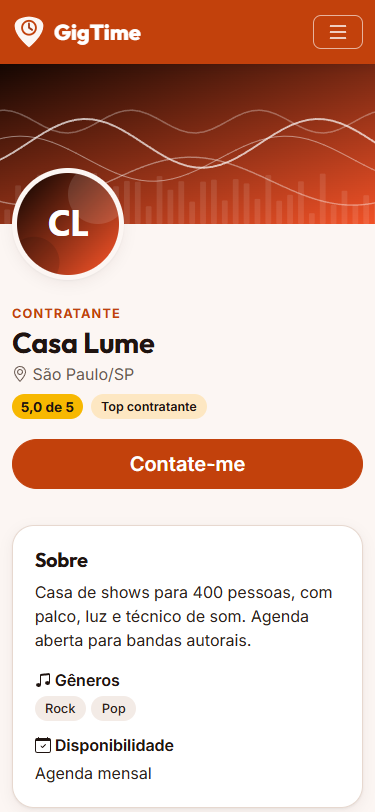
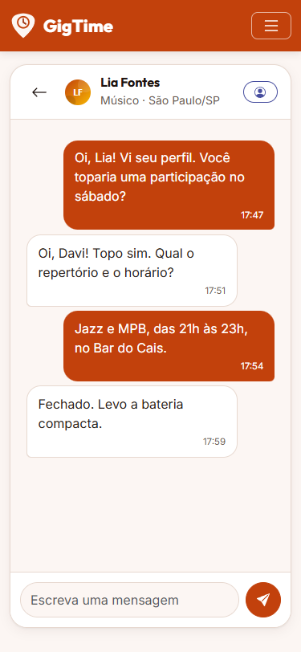
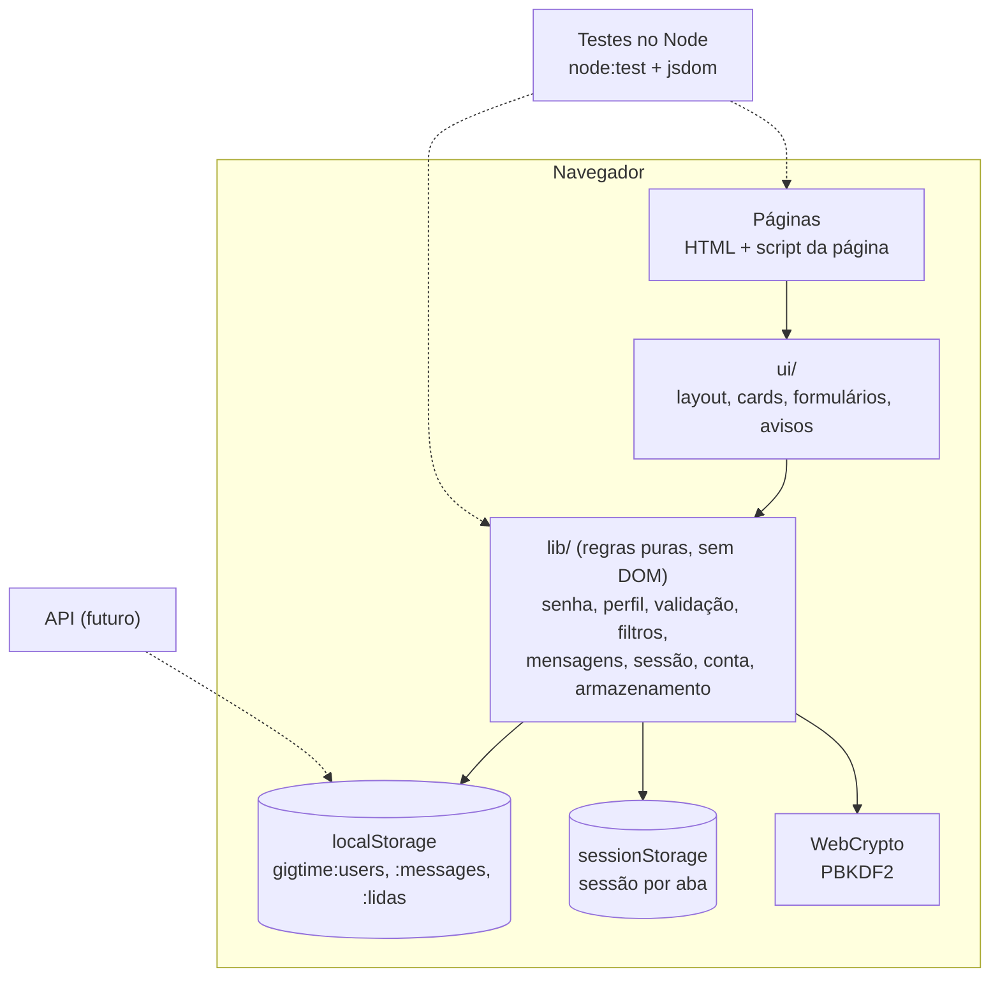

# GigTime

**Música ao vivo, sem complicação.** O GigTime conecta músicos e quem contrata música ao vivo (bares, casas de shows, eventos): perfis com repertório e avaliações, busca por gênero e região e conversa direta.

### ▶ [Abrir a demonstração](https://SEU-USUARIO.github.io/gigtime/)

<!-- Link provisório: troque pelo endereço real depois de publicar (passo a passo em docs/deploy.md). -->

Entre com um clique: **[Entrar como músico](https://SEU-USUARIO.github.io/gigtime/codigo-fonte/Login/login.html?demo=musico)** · **[Entrar como contratante](https://SEU-USUARIO.github.io/gigtime/codigo-fonte/Login/login.html?demo=contratante)**
(ou digite `lia.batera` / `casa.lume`, senha `demo1234`). Para ver o chat funcionando, abra uma aba como músico e outra como contratante.



É um site estático, sem servidor, que nasceu como projeto acadêmico (PUC Minas, 2024) e foi revisado como peça de portfólio, com foco em arquitetura, segurança, acessibilidade, testes e teste de carga. Tudo o que você cadastra fica só no seu navegador.

## O que dá para fazer

| | |
|---|---|
| **Explorar** perfis com filtro por papel, estado, avaliação, gêneros e busca por nome ou cidade. O filtro fica no endereço e pode ser compartilhado. |  |
| **Perfil** com apresentação, disponibilidade, selos, fotos de destaque e vídeo do YouTube. Cada perfil tem endereço próprio (`perfil.html?u=lia.batera`). |  |
| **Mensagens** com lista de conversas, contador de não lidas, atualização entre abas e carregamento das mensagens antigas sob demanda. |  |
| **Conta e dados**: trocar a senha, baixar os próprios dados em JSON, apagar a conta, restaurar a demonstração. |  |

Também há cadastro com validação e login automático, edição de perfil, páginas de Sobre, Privacidade, Esqueci a senha (honesta: não há e-mail), Você saiu, Sessão expirada, Erro e 404. Tudo responsivo:

<p>
  
  
  
  
</p>

## Por que não tem servidor

O escopo da disciplina era front-end (HTML, CSS e JavaScript) e o site é publicado como página estática. Por isso **todos os dados ficam no navegador de quem usa** (Web Storage). Isso é assumido na interface: há um selo "Demo · dados só neste navegador" em todas as páginas, um aviso no cadastro para não usar uma senha real e uma página de Privacidade que lista tudo o que é guardado.

## Arquitetura



```
codigo-fonte/
  <Página>/          uma pasta por página: HTML, script e CSS próprios
  lib/               regras de negócio puras (UMD: window.GigX no navegador, module.exports no Node)
  ui/                peças de interface comuns (topo, rodapé, cards, formulários, avisos)
  assets/            tokens.css, base.css, componentes.css, fontes, ícones, logo e ilustrações
  dados/             personas de demonstração (geradas por ferramentas/gerar-demo.js)
  vendor/bootstrap/  Bootstrap 5.3.3 servido pelo próprio site
testes/              testes automatizados (node:test + jsdom)
ferramentas/         servidor local, geradores (demo, 404, vendor, prints) e medidores de carga
docs/                prints, resultados do teste de carga
documentos/          documentação acadêmica original (com o estado atual anexado)
```

## Decisões técnicas

- **Sem build.** Scripts clássicos na mesma ordem em todas as páginas; o site roda em qualquer servidor estático e os testes usam exatamente o mesmo código.
- **Regras separadas da tela e do armazenamento.** As funções de `lib/` recebem o `storage` como parâmetro: nos testes é um objeto em memória; no futuro, uma API pode ocupar o lugar sem reescrever as telas.
- **Gravação defensiva.** Antes de gravar, a lista é relida (outra aba pode ter mudado algo enquanto a senha era processada), a cota cheia é tratada com mensagem na tela e as migrações de versões antigas só mexem em dados com o formato do GigTime (no GitHub Pages a origem é dividida com outros sites).
- **Conteúdo próprio.** Personas fictícias e ilustrações geradas por script; nenhuma imagem de terceiros.

## Segurança

- **Senhas com PBKDF2-SHA256**, sal aleatório de 16 bytes e 600 mil iterações (WebCrypto). Hashes antigos (SHA-256 com o usuário como sal, ou texto puro) são trocados no próximo login, sem o usuário perceber.
- **Ações sensíveis pedem a senha**: salvar o perfil, trocar a senha, apagar a conta.
- **CSP por `<meta>`** em todas as páginas (o GitHub Pages não permite cabeçalhos): `script-src 'self'` e `style-src 'self'`, sem nada inline; o 404 da raiz usa hash SHA-256 para o seu único script.
- **Nada de CDN**: Bootstrap, fontes e ícones servidos pelo site (o Bootstrap é idêntico ao do CDN, mesmo hash SRI).
- **Dado de usuário nunca vira HTML**: entra por `textContent` ou passa por escape; links de imagem só `https://`; o vídeo é montado só pelo ID de 11 caracteres do YouTube, no domínio `youtube-nocookie.com`.
- **Redirecionamento pós-login validado** (só caminhos relativos do próprio site), **sessão que expira** após 2 horas sem uso e página oculta se aberta dentro de um iframe de outro site (clickjacking).
- **Revisão de segurança independente** sobre o diff: o único achado médio (open redirect pelos links calculados do 404) foi corrigido com teste.
- **Limitação assumida:** sem servidor, a autenticação é demonstrativa. Quem controla o navegador (DevTools) consegue gravar outra pessoa na sessão; a senha e o PBKDF2 protegem contra uso casual e contra quem só copia os dados.

## Acessibilidade e identidade visual

- Tokens de cor num arquivo só (`assets/css/tokens.css`), com **contraste WCAG AA verificado em teste**. Laranja escuro `#c2410c` para navbar e botões, índigo `#484f9f` para links, amarelo `#f7b801` com texto escuro para selos.
- Fontes Outfit (títulos) e Inter (texto), um único conjunto de ícones e logo própria (palheta de guitarra com relógio).
- Foco visível, link "Pular para o conteúdo", navegação por teclado (lista do chat, filtros, galeria em `<dialog>`), erros ligados aos campos (`aria-invalid`, `aria-describedby`) e avisos em região `aria-live` no lugar de `alert()`.

## Testes

**286 testes** automatizados (`npm install` e `npm test`, Node.js 22 ou superior; os testes não fazem parte do site publicado), com `node:test` e `jsdom` com `node:test` e `jsdom`: regras de `lib/`, páginas reais carregadas com os seus scripts (preencher, enviar, clicar) e testes de arquitetura (CSP em todas as páginas, contraste dos tokens, ícones existentes no sprite, estrutura comum).

## Teste de carga

Sem servidor, o que se estressa é o navegador: milhares de perfis, dezenas de milhares de mensagens, a cota do localStorage e duas abas gravando ao mesmo tempo. As hipóteses foram escritas antes de medir ([hipóteses](docs/carga/2026-10-04-hipoteses.md)) e cada cenário rodou 5 vezes no Chrome, antes e depois das correções ([resultados completos](docs/carga/2026-10-04-resultados.md)).


| Cenário (mediana) | Antes | Depois |
|---|---|---|
| Trocar o filtro com 5 mil perfis | 1,2 s | 24 ms |
| Abrir o chat com 25 mil mensagens | 727 ms | 254 ms |
| Enviar uma mensagem com 25 mil gravadas | 511 ms | 43 ms |
| Duas abas enviando 500 mensagens cada | 40% perdidas | 0 perdidas |
| Lighthouse da Home (desktop): desempenho / acessibilidade | não pintava (tela em branco até o `load`) | 98 / 100 |
| Cadastro com o armazenamento cheio | erro não tratado, sem aviso | aviso na tela |

O que as medições mudaram no código: filtro sobre os dados com `Map` (era O(n²)), paginação em Explorar e no chat, uma chave de mensagens por autor (uma trava Web Locks foi testada e não resolveu; ver [ADR 0003](docs/adr/0003-mensagens-por-autor.md)). Fora da meta e registrado: LCP de 4,1 s no celular simulado, por causa do CSS inteiro do Bootstrap.

## Limitações

- Dados presos a um navegador: não há sincronização entre dispositivos.
- Cota do localStorage de cerca de 5 MB.
- Avaliações e selos são fixos (não há fluxo de avaliação depois do show).
- Fotos são links para outros sites, que podem ver o IP de quem abre o perfil.
- Mensagens só chegam com o site aberto (sem notificação). Duas abas da mesma pessoa enviando ao mesmo tempo ainda podem colidir (pessoas diferentes, não).

## Rodar localmente

Pré-requisito: Windows com Python ou PowerShell (já vem no Windows), ou qualquer sistema com Python.

1. Baixe ou clone o repositório.
2. No Windows, dê dois cliques em **`iniciar.bat`**. Ele serve a pasta `codigo-fonte` em `http://localhost:8000` e abre o navegador.
   Em outros sistemas: `python -m http.server 8000 --bind 127.0.0.1 --directory codigo-fonte` e abra `http://localhost:8000/Home/home.html`.
3. Use "Entrar como músico" ou "Entrar como contratante".

O site precisa ser aberto por HTTP (localhost ou https): aberto direto do disco (`file://`), o navegador isola o armazenamento de cada página e desliga a criptografia usada nas senhas.

**Publicar a sua cópia:** o workflow `.github/workflows/pages.yml` publica no GitHub Pages a cada push na `main`; o passo a passo está em [docs/deploy.md](docs/deploy.md).

## Decisões registradas (ADRs)

- [0001: site estático, sem back-end](docs/adr/0001-site-estatico-sem-back-end.md)
- [0002: modo demonstração num site sem servidor](docs/adr/0002-modo-demo.md)
- [0003: uma chave de mensagens por autor](docs/adr/0003-mensagens-por-autor.md)

## Próximos passos

1. API real (Node ou .NET) com autenticação no servidor, substituindo o armazenamento local em `lib/armazenamento.js`.
2. Gerar só o CSS do Bootstrap que o site usa, para baixar o LCP no celular.
3. Avaliação depois do show, que alimente a nota e os selos.
4. Publicação de "gigs" (vagas) pelos contratantes, com candidatura dos músicos.
5. IndexedDB para conversas grandes, se o site continuar sem servidor.

## Equipe

**Projeto original (2024)**, Análise e Desenvolvimento de Sistemas, PUC Minas: Carlos Henrique Pereira Silva, Jefferson Luiz Mendonça da Silva, Kauã Eduardo Silva, Lucas Carvalho de Oliveira e William Rocha Leal Viana. Orientador: Humberto Azevedo Nigri do Carmo.

**Revisão para portfólio (2026)**, por Jefferson Luiz Mendonça da Silva: segurança, reorganização em camadas, identidade visual, acessibilidade, páginas novas, testes automatizados e teste de carga.

## Documentação acadêmica

1. [Documentação de Contexto](documentos/01-Documentação%20de%20Contexto.md)
2. [Especificação do Projeto](documentos/02-Especificação%20do%20Projeto.md) (com o estado atual dos requisitos)
3. [Metodologia](documentos/03-Metodologia.md)
4. [Projeto de Interface](documentos/04-Projeto%20de%20Interface.md)
5. [Template padrão da Aplicação](documentos/05-Template%20padrão%20da%20Aplicação.md)
6. [Programação de Funcionalidades](documentos/06-Programação%20de%20Funcionalidades.md)
7. [Plano de Testes de Software](documentos/07-Plano%20de%20Testes%20de%20Software.md)
8. [Registro de Testes de Software](documentos/08-Registro%20de%20Testes%20de%20Software.md)
9. [Referências Bibliográficas](documentos/09-Referências%20Bibliográficas.md)
