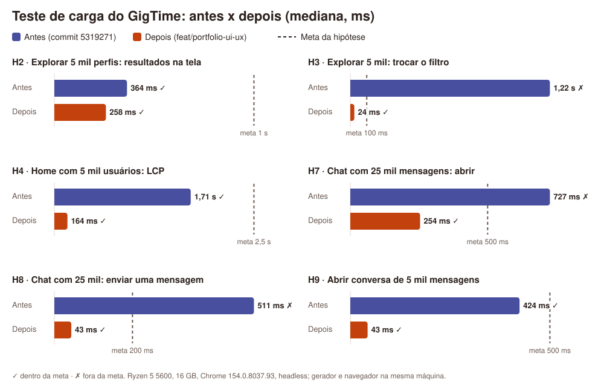

# Teste de carga do GigTime: resultados

Data: 2026-10-04. As hipóteses foram escritas e versionadas **antes** das medições: ver [`2026-10-04-hipoteses.md`](2026-10-04-hipoteses.md) (commit `92005b2`). Os números resumidos estão em [`2026-10-04-medicoes.json`](2026-10-04-medicoes.json).



## Como foi medido

- **Antes:** commit `5319271` (main), servido de uma worktree temporária na porta 8812. **Depois:** branch `feat/portfolio-ui-ux`, porta 8811. Os dois sites foram servidos por `python -m http.server` (o mesmo do `iniciar.bat`).
- **Navegador:** Chrome 154 instalado, headless, comandado por `playwright-core` (`ferramentas/carga/medir-navegador.js`). Cada cenário rodou **5 vezes** num contexto limpo; o gráfico mostra a mediana e as tabelas trazem também o **máximo** (o maior valor entre todas as amostras; com 5 a 25 amostras não faz sentido falar em p95).
- **Dados:** gerados por `ferramentas/carga/gerar-dados.js` (determinístico, sem dado real) e gravados no localStorage antes de abrir a página. As imagens dos perfis gerados são locais, e o Bootstrap da versão antes foi servido a partir de uma cópia local idêntica à do CDN. Assim a rede fica fora da medição de JavaScript e DOM.
- **"Até o próximo frame":** a ação síncrona (trocar o filtro, enviar, clicar) mais `requestAnimationFrame` e `setTimeout(0)`. É uma aproximação do INP.
- **Lógica pura:** medida em Node com `performance.now()` (`medir-node.js`), 15 repetições depois de aquecer o JIT, usando a `lib/` de cada versão.
- **Lighthouse 12** (`medir-lighthouse.js`): 3 execuções por página e perfil, mediana. **autocannon 8** (`medir-servidor.js`): degraus de 1, 10 e 50 conexões, 10 s cada, depois de 3 s de aquecimento.
- **Máquina:** Ryzen 5 5600 (6 núcleos/12 threads), 16 GB. Gerador, navegador e servidor dividem a máquina, e outros projetos da oficina estavam rodando ao mesmo tempo: a CPU média ficou entre 50 e 100% e a memória livre caiu a menos de 100 MB em alguns momentos (campos `recursos_*` do JSON). Por isso os máximos oscilam; a comparação vale **entre antes e depois**, não como número absoluto.
- A trava `.carga-lock` foi usada para não medir junto com a carga de outro projeto. Depois se descobriu que outro projeto da oficina mediu sem respeitar a trava em 04/10, das 18:26 às 18:47. O Lighthouse do GigTime rodou antes disso (18:06 e 18:18, campos `quando` do JSON). Os cenários de navegador não guardaram horário e foram registrados às 18:45, então parte deles pode ter coincidido. A concorrência aumenta o ruído de quem estiver medindo naquele momento (como os `recursos_*` já mostram), mas as conclusões se apoiam em medianas e em diferenças de 10 a 50 vezes, bem maiores que esse ruído; por isso foram mantidas.

## Resultado por hipótese

| # | Cenário | Meta | Antes (mediana / máx.) | Depois (mediana / máx.) | Hipótese |
|---|---|---|---|---|---|
| H1 | Node: filtrar 10 mil; `listarConversas` e `conversaEntre` em 100 mil | < 5 / 50 / 50 ms | 0,2 / 4,0 / 2,3 ms | 0,2 / 2,2 / 1,8 ms | **Confirmada** nas duas versões |
| H1b | Node: laço da página Explorar com 5 mil cards | (diagnóstico) | 67 ms (`find` por card, O(n²)) | 0,7 ms (`Map`) | Causa do H3 confirmada |
| H2 | Explorar com 5 mil perfis: resultados na tela | < 1000 ms | 364 / 642 ms (5 mil cards) | 258 / 390 ms (primeira página, 24 cards) | **Confirmada** nas duas |
| H3 | Explorar com 5 mil: trocar o filtro | < 100 ms | **1216 / 2417 ms** | 24 / 36 ms | Antes **falhou**, como previsto; depois confirmada |
| H4 | Home com 5 mil usuários: LCP | < 2500 ms | 1708 / 1988 ms | 164 / 1388 ms | **Refutada** para o antes (passou); depois 10 vezes menor |
| H5 | Cota de usuários; cadastro com o armazenamento cheio | estoura entre 5 e 7 mil; cadastro avisa | 11.647 usuários (442 caracteres cada); cadastro **sem aviso** (erro não tratado: `exceeded the quota`) | 8.846 usuários (585 caracteres, com apresentação); cadastro **avisa na tela** | Faixa **refutada** (os usuários gerados são menores que o estimado); aviso: antes falhou, depois confirmado |
| H6 | Cota de mensagens de 50 caracteres; envio com o armazenamento cheio | entre 30 e 36 mil; avisa e não perde | 35.643; avisa por `alert()`; nada perdido | 35.642; avisa na tela (sem `alert`); nada perdido | **Confirmada** |
| H7 | Chat com 25 mil mensagens (5 mil na conversa): abrir | < 500 ms | **727 / 1412 ms** (5 mil balões) | 254 / 315 ms (100 balões) | Antes **falhou**; depois confirmada |
| H8 | Chat com 25 mil: enviar uma mensagem | < 200 ms | **511 / 722 ms** | 43 / 50 ms | Antes **falhou**; depois confirmada |
| H9 | Abrir pela lista a conversa de 5 mil mensagens | < 500 ms | 424 / 461 ms | 43 / 59 ms | **Refutada** para o antes (passou, por pouco) |
| H10 | 2 abas × 500 envios a cada 10 ms | 0 perdidas | **2001 de 5000 perdidas (40%)** | 0 de 5000 | Antes **falhou**; depois confirmada (ver abaixo) |
| H11 | Lighthouse | ver tabela | Home sem FCP | ver tabela | ver tabela |
| H12 | Hash da senha no Chrome | SHA-256 < 5 ms; PBKDF2 < 1000 ms | SHA-256: 0,1 ms | PBKDF2 600 mil: 116 / 138 ms | **Confirmada** |
| H13 | autocannon no servidor local | > 500 req/s, p99 < 50 ms | ver abaixo | ver abaixo | **Inconclusiva**: o servidor de desenvolvimento derrubou conexões e os números não medem o site |

### H11: Lighthouse (mediana de 3 execuções)

| Página e perfil | Antes: desempenho / acessibilidade / LCP | Depois: desempenho / acessibilidade / LCP |
|---|---|---|
| Home, desktop | **sem FCP** nas 3 execuções (`NO_FCP`) | 98 / 100 / 0,8 s |
| Home, celular | **sem FCP** nas 3 execuções | 78 / 100 / 4,1 s |
| Explorar, desktop | 88 / 94 / 1,1 s (só 1 de 3 execuções pintou; falha de contraste) | 96 / 100 / 0,9 s |
| Explorar, celular | **sem FCP** nas 3 execuções | 75 / 100 / 4,3 s |

Na versão antes, o `body` ficava com `visibility: hidden` até o evento `load`, que esperava todas as imagens externas (Pexels, Picsum, Tumblr...). O Lighthouse não chegou a ver conteúdo pintado: é a medição objetiva do "tela em branco" apontado na auditoria. Depois: desempenho ≥ 96 no desktop e ≥ 75 no celular, acessibilidade 100 nas duas páginas, boas práticas 100.

**Fora da meta:** o LCP no celular (4,1 a 4,3 s no perfil simulado de 4G lento com CPU 4 vezes mais lenta). O que pesa é o CSS do Bootstrap inteiro (227 KB) bloqueando a renderização. Fica registrado como próximo passo (gerar só o CSS usado).

### H13: servidor local (inconclusivo)

A medição com autocannon contra o `python -m http.server` (o servidor do `iniciar.bat`) **não é confiável** e fica marcada como inconclusiva. O servidor de desenvolvimento recusou e derrubou conexões: nos degraus de 10 e 50 conexões o autocannon registrou mais erros (cerca de 7.500 e 12.300) do que respostas, e as latências gravadas não fecham com as requisições por segundo (por exemplo, 1 conexão com centenas de req/s e mediana de segundos). Por isso nenhum número de latência ou vazão é citado aqui.

O que dá para afirmar: o `python -m http.server` só serve para rodar o site localmente, um usuário por vez; em produção o site é servido pelo GitHub Pages (CDN), onde esse limite não existe. A hipótese H13 foi mal formulada para esse servidor. Para medir de verdade seria preciso servir o site com um servidor estático de produção (por exemplo, nginx) ou medir o próprio Pages, o que fica fora do escopo desta rodada.

## O que foi corrigido por causa das medições

1. **Filtro O(n²) em Explorar (H3):** o filtro antigo fazia `users.find` para cada card. Agora o filtro roda sobre os dados (`GigFiltros.filtrarUsuarios`) e o card é achado por `Map`.
2. **Desenho de milhares de cards (H2):** na primeira versão da revisão, desenhar os 5 mil cards novos (com ícones SVG) custava cerca de 0,8 s só de parse de HTML. Explorar passou a mostrar 24 perfis por vez com "Mostrar mais perfis", e o resultado chega na tela em cerca de 0,26 s.
3. **Home (H4):** mostra só os 4 mais bem avaliados de cada papel, e a página não fica mais escondida até o `load`.
4. **Chat (H7, H8, H9):** mostra as 100 mensagens mais recentes, com "Carregar mensagens anteriores"; os usuários viram um `Map` por desenho; o contador de não lidas reaproveita a lista já lida (antes eram três `JSON.parse` de 4 MB por desenho).
5. **Mensagens perdidas entre abas (H10):** com uma lista única, as duas abas liam a mesma lista e a última gravação apagava a mensagem da outra (40% de perda). Uma primeira tentativa com Web Locks **não resolveu** (as rodadas continuaram perdendo 15 a 22%), porque o localStorage propaga as mudanças entre abas de forma assíncrona e a aba lê uma cópia ainda desatualizada mesmo dentro da trava. A correção definitiva foi gravar cada mensagem na chave do próprio autor (`gigtime:messages:<usuário>`): duas pessoas nunca escrevem a mesma chave. Resultado: **0 de 5.000 perdidas**.
6. **CLS no Lighthouse:** a lista de resultados reserva altura, para o rodapé não "pular" quando os cards chegam.

## Limitações da medição

- A máquina estava ocupada por outros projetos durante as medições (ver `recursos_*`): os máximos têm ruído. As conclusões usam a mediana e diferenças grandes (10 a 50 vezes).
- H2 mede coisas diferentes nas duas versões, por desenho: o antes desenhava 5 mil cards; o depois desenha a primeira página. O que importa para quem usa é o tempo até ver resultados.
- H10 com duas abas da **mesma pessoa** ainda pode perder mensagens (as duas escrevem a mesma chave). É raro e está registrado nas limitações do README.
- O Lighthouse foi rodado contra o servidor local, não contra o GitHub Pages; no Pages há compressão e cache de CDN, então os números tendem a ser melhores.

## Como repetir

```
npm install
# servidor da versão a medir (outra porta para a versão antiga)
python -m http.server 8811 --bind 127.0.0.1 --directory codigo-fonte
node ferramentas/carga/medir-node.js <codigo-fonte-da-versao-antiga> node.json
node ferramentas/carga/medir-navegador.js depois http://127.0.0.1:8811 navegador-depois.json
LIGHTHOUSE_BIN=<lighthouse instalado> node ferramentas/carga/medir-lighthouse.js depois http://127.0.0.1:8811 lighthouse-depois.json
node ferramentas/carga/medir-servidor.js http://127.0.0.1:8811/Home/home.html servidor-depois.json   # H13: só com um servidor estático de produção
node ferramentas/carga/resumir.js <pasta-dos-json> 2026-10-04
```
