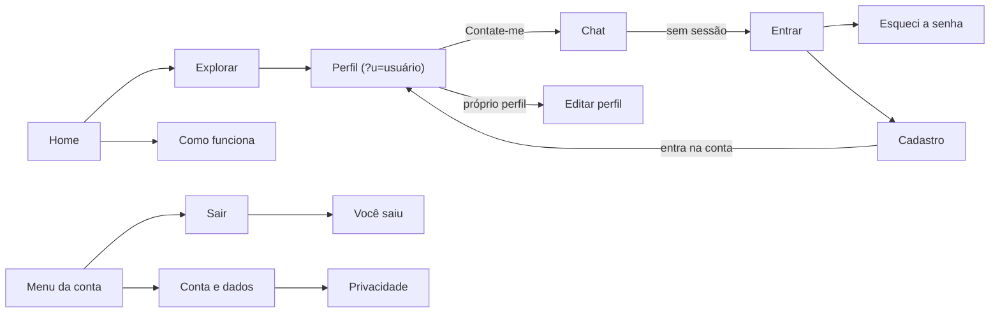
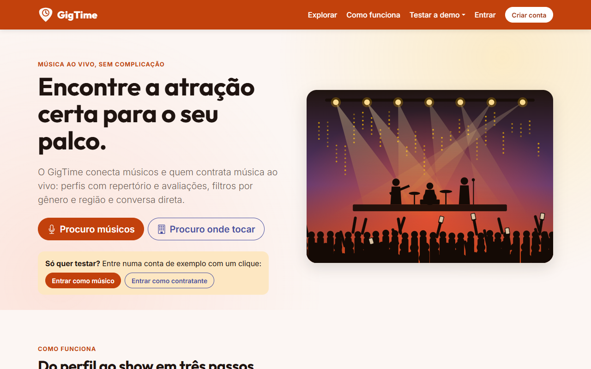
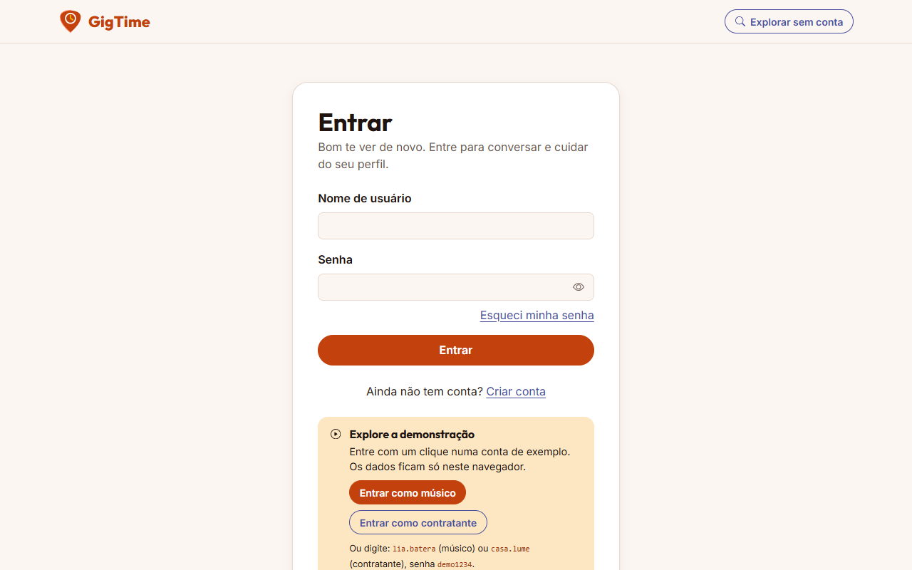
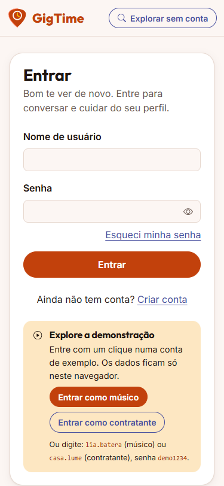
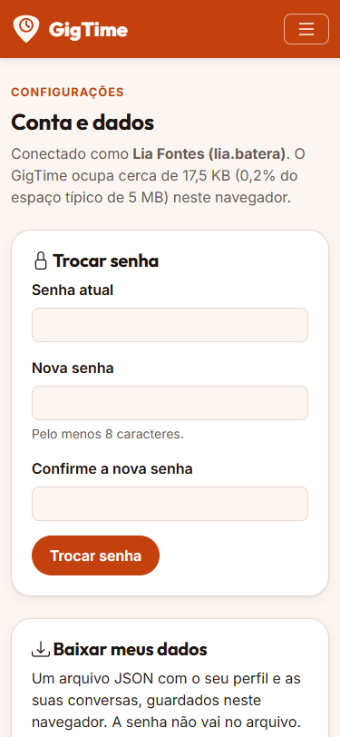

# Projeto de Interface

O projeto foi desenvolvido estabelecendo que a interface do sistema atenderia a todos os requisitos previamente definidos nos requisitos não funcionais e funcionais. Este projeto também teve como objetivo proporcionar uma compreensão detalhada da usabilidade do sistema, com foco principal na área de desktop.

## User Flow

Elaboramos um fluxograma para demonstrar o fluxo de interação do usuário pelas telas do sistema, utilizando a ferramenta Figma. A Figura 1, apresentada em anexo, proporciona uma compreensão mais aprofundada da usabilidade do sistema. Para obter mais detalhes sobre a usabilidade, acesse o link fornecido: [Projeto de baixa fidelidade](https://www.figma.com/design/onmbViV0CZKPLkAwXNwSYa/GigTime-(Prot%C3%B3tipo-Baixa-Fidelidade)?node-id=0-1&t=uz7gUVQyMQYzQ7yD-1)

### Wireframe

Com base no fluxo do usuário, apresentamos, em sequência, as telas que compõem o sistema. A estrutura principal do sistema é dividida em três blocos, descritos da seguinte forma:

Cabeçalho: contém os elementos fixos que representam a identidade do projeto, como o logotipo, a barra de pesquisa e a navegação principal do site (menu de navegação). Esses elementos seguem em todas as páginas do projeto.

Conteúdo: exibe os elementos que fazem referência à tela atual do usuário, também baseados nas ações do mesmo.

Rodapé: inclui os elementos de direitos autorais do projeto.

### Tela - Landing Page

Página inicial com informações do site e opções para navegação de músicos e contratantes.

### Tela - Registro

Formulário para novos usuários se cadastrarem como músicos ou contratantes.

### Tela - Login

Tela onde usuários entram no sistema usando suas credenciais.

### Tela - Anúncios

Espaço onde contratantes e músicos publicam seus anúncios.

### Tela - Visualização de Perfil

Exibe informações públicas dos perfis de músicos ou contratantes.

### Tela - Chat

Sistema de mensagens para comunicação entre músicos e contratantes.

---

## Interface atual (revisão de portfólio, 2026)

O fluxo e os wireframes acima são os do projeto original e ficam como histórico. Duas diferenças: a "barra de pesquisa" do cabeçalho virou a busca da página Explorar, e o rodapé agora existe em todas as páginas (com o selo "Demo · dados só neste navegador").

### Fluxo atual

### Telas

Prints tirados no Chrome a partir do código atual (`ferramentas/capturar-telas.js`), em 1280 px e em 375 px.

| Tela | Desktop | Celular |
|------|---------|---------|
| Home |  |  |
| Explorar |  |  |
| Perfil |  |  |
| Mensagens |  |  |
| Entrar |  |  |
| Conta e dados |  |  |

### Estados de interface

Toda lista tem estado de carregando, vazio e erro: Explorar sem resultado ("Nenhum perfil com esses filtros", com botão para limpar), perfil não encontrado, chat sem conversas, imagem externa que não carrega (troca pela ilustração padrão). Sucesso e erro aparecem em avisos (toast) numa região `aria-live`, no lugar de `alert()`, e ações destrutivas usam um diálogo próprio com o foco começando em "Cancelar".
